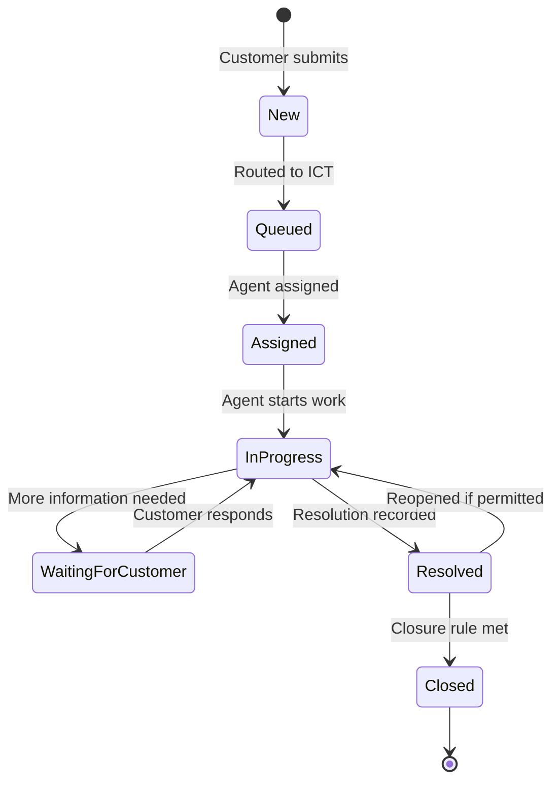

# Software Requirements Specification (SRS)

**Project:** CBSUA Ticketing and Queueing System  
**Primary application:** Frappe Helpdesk  
**Document status:** Baseline draft for stakeholder review  
**Initial operational office:** ICT Office  
**Planned expansion:** Registrar, Admissions, Cashier

## 1. Purpose

This SRS defines the requirements for implementing a CBSUA-branded ticketing and digital service queueing system using Frappe Helpdesk. It is intended for project handover, implementation planning, testing, and change control.

## 2. Product scope

The system shall provide a shared Frappe Helpdesk Site per environment for customers to submit and track service tickets and for authorized office personnel to receive, queue, assign, process, and resolve them. The Site is shared across participating office teams; it is not a separate Site per office. A clean test Site is an environment-isolation check and does not by itself prove safe migration of existing tickets or office-level security.

### 2.1 In scope

- Customer ticket submission and permitted ticket tracking.
- Ticket classification, priority, status, and reference number.
- Office-based queues and team assignment.
- Agent and manager access controls.
- Customer replies and internal agent comments.
- Ticket reassignment, escalation, resolution, and closure.
- Notifications and configurable service targets.
- Operational reports and queue monitoring.
- A reusable process for onboarding additional CBSUA offices.

### 2.2 Out of scope unless separately approved

- General-purpose CRM, sales, or marketing functionality.
- Student information system or enrollment management.
- Payment processing or cashier transaction processing.
- Registrar or Admissions business-process automation.
- A physical walk-in queue with numbered tokens, counter displays, or turn calling.
- Custom ticket engine replacing Frappe Helpdesk.

**Queueing definition:** In this project, queueing means the digital handling of submitted tickets (for example, unassigned, assigned, in progress, waiting, resolved). A physical counter queue is a separate system capability and is not included in this baseline.

## 3. Deployment phases

| Phase | Office | Scope |
|---|---|---|
| 1 | ICT | First operational office; complete intake-to-resolution workflow |
| 2 | Registrar | Add Registrar team, categories, access, routing, service targets, and reports |
| 3 | Admissions | Add Admissions team, categories, access, routing, service targets, and reports |
| 4 | Cashier | Add Cashier team, categories, access, routing, service targets, and reports |

The platform is designed for multiple offices, but only ICT shall be enabled as a customer-facing destination during Phase 1. Future offices must not be activated until their configuration and access isolation have passed testing.

## 4. Stakeholders and user classes

| User class | Phase 1 | Future phases | Main responsibilities |
|---|---|---|---|
| Customer / Requester | Active | Active | Submit tickets, provide information, view permitted updates |
| ICT Agent | Active | — | Process ICT tickets |
| ICT Manager | Active | — | Monitor ICT queue and coordinate ICT agents |
| Registrar Agent / Manager | Not provisioned | Active in Registrar phase | Process and oversee Registrar tickets |
| Admissions Agent / Manager | Not provisioned | Active in Admissions phase | Process and oversee Admissions tickets |
| Cashier Agent / Manager | Not provisioned | Active in Cashier phase | Process and oversee Cashier tickets |
| System Administrator | Active | Active | Platform-wide configuration, accounts, and administration |

## 5. Functional requirements

Priority convention: **Must** = required for the relevant phase; **Should** = desirable; **Future** = required only when additional offices are onboarded.

### 5.1 Ticket intake and customer access

| ID | Priority | Requirement |
|---|---|---|
| FR-01 | Must | The system shall allow a customer to submit a ticket through the configured customer-facing channel. |
| FR-02 | Must | The system shall record a subject, description, requester identity/contact, creation timestamp, and configured required fields. |
| FR-03 | Must | The system shall assign a unique ticket reference. |
| FR-04 | Must | The system shall support ticket classification and priority. |
| FR-05 | Must | Customers shall be able to view permitted ticket details and updates according to the approved customer-access policy, including the approved policy for contacts who belong to the same customer organization. |
| FR-06 | Should | Authorized agents shall be able to create tickets on behalf of customers for requests received by phone or in person. |
| FR-07 | Must | The system shall support customer communication associated with a ticket. |

### 5.2 Office identification and routing

| ID | Priority | Requirement |
|---|---|---|
| FR-08 | Must | Each CBSUA ticket shall be associated with one responsible service office and its mapped native Helpdesk Team. The Helpdesk Team shall be mapped to no more than one Service Office. Existing unclassified tickets are governed by the approved legacy-ticket policy. |
| FR-09 | Must | During Phase 1, ICT shall be the only enabled office destination. |
| FR-10 | Must | The design shall support adding Registrar, Admissions, and Cashier without creating separate Helpdesk installations. |
| FR-11 | Must | New CBSUA tickets shall be routed server-side to the single active, intake-enabled Service Office and its existing, enabled Helpdesk Team. Creation shall fail closed if there is no unique active destination or its Team is missing or disabled; customers shall not choose or override the office/team assignment. |
| FR-12 | Must | Tickets shall be assignable to a team and, where applicable, an individual agent. |
| FR-13 | Must | Authorized managers shall be able to reassign or escalate tickets within their approved scope. |
| FR-14 | Future | Customers shall be able to select among approved office destinations after those offices are activated and each destination's office mapping, access policy, and intake validation have passed the onboarding gate. |

### 5.3 Queue and assignment management

| ID | Priority | Requirement |
|---|---|---|
| FR-15 | Must | Authorized ICT staff shall have a view of unassigned ICT tickets. |
| FR-16 | Must | Agents shall have views of tickets assigned to them and/or their authorized team, subject to permissions. |
| FR-17 | Must | The system shall support manual assignment. |
| FR-18 | Should | The system shall support automatic assignment through configured Helpdesk assignment capabilities. |
| FR-19 | Should | The system shall support a suitable workload-based or round-robin assignment strategy if supported by the selected release and approved by ICT. |
| FR-20 | Must | Managers shall be able to monitor pending and active tickets within their office. |
| FR-21 | Must | The system shall support filtering or views by status, priority, team, assignee, category, and age where supported. |

### 5.4 Ticket processing and resolution

| ID | Priority | Requirement |
|---|---|---|
| FR-22 | Must | Agents shall be able to view ticket details and requester information necessary to process the request. |
| FR-23 | Must | Agents shall be able to send customer-visible replies. |
| FR-24 | Must | Agents shall be able to add internal comments not visible to customers. |
| FR-25 | Must | Agents shall be able to update ticket status and priority within their permissions. |
| FR-26 | Must | Agents shall be able to request additional information from customers. |
| FR-27 | Must | Agents shall be able to record a resolution and resolve a ticket. |
| FR-28 | Must | The system shall support closure according to the approved workflow. |
| FR-29 | Should | The system shall support reopening a ticket when permitted by the configured workflow. |
| FR-30 | Must | Ticket conversation and status history shall remain associated with the ticket. |

### 5.5 Staff authentication and authorization

| ID | Priority | Requirement |
|---|---|---|
| FR-31 | Must | Staff shall authenticate before accessing agent functions. |
| FR-32 | Must | Only authorized ICT personnel shall receive agent access during Phase 1. |
| FR-33 | Must | Authorized administrators shall be able to invite, activate, and deactivate staff accounts using supported platform functions. |
| FR-34 | Must | Staff shall receive roles and team membership appropriate to their duties. |
| FR-35 | Must | Disabled staff accounts shall not be able to access agent functions. |
| FR-36 | Must | Agents shall not access tickets outside their authorized scope through any supported ticket list, direct document route, API, Helpdesk search, report/export, conversation, or attachment/download path. Approved cross-office administrators are handled as explicit exceptions. |
| FR-37 | Must | Office managers shall not receive broader platform administration rights unless explicitly approved. Platform-wide administrator and cross-office support exceptions shall be named and reviewed separately from office-team permissions. |
| FR-38 | Future | Authorized staff from each new office shall be provisioned during that office's onboarding. |

### 5.6 SLA and notifications

| ID | Priority | Requirement |
|---|---|---|
| FR-39 | Must | The ICT implementation shall define approved first-response and resolution targets before production use. |
| FR-40 | Must | The system shall apply the configured SLA policy and working calendar, subject to the selected Helpdesk release's capabilities. |
| FR-41 | Must | Relevant agents shall be notified of new tickets and relevant assignment changes through configured channels. |
| FR-42 | Must | Customers shall receive configured notifications for relevant ticket events. |
| FR-43 | Must | Authorized staff shall be able to identify tickets approaching or exceeding service targets where supported. |
| FR-44 | Future | Each additional office shall have separately approved service targets and working calendars where needed. |

### 5.7 Reporting and monitoring

| ID | Priority | Requirement |
|---|---|---|
| FR-45 | Must | ICT managers shall be able to monitor ticket counts by status. |
| FR-46 | Must | ICT managers shall be able to monitor unassigned and assigned workload. |
| FR-47 | Must | Authorized users shall be able to review response and resolution performance where the data is available. |
| FR-48 | Must | System administrators shall be able to monitor platform-wide ticket activity. |
| FR-49 | Future | Reports shall support office-level filtering and consolidated cross-office reporting. |

## 6. Non-functional requirements

| ID | Requirement |
|---|---|
| NFR-01 | The system shall use HTTPS for all production browser access. |
| NFR-02 | Staff access shall require authentication. |
| NFR-03 | Ticket access shall enforce role, team, and office authorization. |
| NFR-04 | Office users shall not be able to access another office's tickets unless explicitly authorized. |
| NFR-05 | Ticket records, conversations, and attachments shall be backed up under an approved backup and recovery procedure. |
| NFR-06 | The platform shall support adding offices without replacing the ticketing application. |
| NFR-07 | Custom code shall be minimized; native Helpdesk configuration shall be preferred. |
| NFR-08 | Customizations shall be version-controlled, documented, and tested against the selected Frappe/Helpdesk versions. |
| NFR-09 | The customer and agent interfaces shall be usable on commonly supported desktop and mobile browsers. |
| NFR-10 | Administrative and ticket-processing activities shall be auditable to the extent supported by the platform and configured logging. |
| NFR-11 | Production deployment shall include monitoring, backup, restore testing, and documented operational ownership. |
| NFR-12 | Office authorization shall be enforced server-side; hiding a ticket or field in the interface alone shall not count as access control. Tests shall cover list queries, direct reads and writes, REST/RPC calls, search, reports/exports, comments, attachments/downloads, direct assignment, unassigned tickets, and approved administrative exceptions. |
| NFR-13 | The office field on a ticket shall be stamped and validated by the server, and clients shall not be able to set or change the classification through REST/RPC requests. Its field permission level and Helpdesk ticket-template visibility shall match an approved decision about customer visibility; template visibility alone shall not be treated as API protection. |
| NFR-14 | Before enabling more than one office, the institution shall approve and apply a policy for existing tickets that have no CBSUA Service Office classification, unassigned/teamless tickets, and other records that predate office routing. |

## 7. Conceptual ticket lifecycle

The exact status names and transitions must be verified against the selected Helpdesk version and approved by the ICT Office.

## 8. Phase 1 acceptance criteria

Phase 1 is accepted when all Must requirements applicable to ICT pass documented tests and their blocking open questions have approved decisions. The clean-Site install is only one part of acceptance; it does not replace role-based security checks or migration planning. Acceptance includes:

1. A customer can submit an ICT ticket through the approved intake channel.
2. The ticket receives a unique reference and appears in the ICT queue.
3. An authorized ICT agent can access and process the ticket.
4. Agents can reply to customers and add internal comments.
5. Agents can update permitted status, priority, and assignment fields.
6. An agent can record a resolution and complete the approved closure workflow.
7. Customers can access only tickets permitted by the approved customer-access policy.
8. ICT managers can monitor the ICT queue and workload.
9. Non-ICT staff cannot access ICT agent functions unless explicitly authorized.
10. Staff account invitation, activation, and deactivation are tested.
11. SLA and notification behavior matches the approved ICT configuration.
12. Backup and restore procedures are documented and tested.
13. The office onboarding procedure is documented for future expansion.
14. Native Helpdesk team restriction settings and exceptions (teamless ticket visibility, directly assigned users, teams that ignore restrictions, and administrative roles) are checked against the approved access matrix.
15. Customer portal access is tested for individual contacts and customer managers under the selected Helpdesk version.
16. The visibility and API exposure of the CBSUA Service Office field matches the approved customer/internal classification policy.
17. Existing unclassified tickets are either backfilled or explicitly excluded from cross-office access before office expansion.
18. New tickets receive their office/team assignment server-side; attempts to set an office on an unclassified ticket or change a tagged ticket's office/team through REST/RPC are rejected.

## 9. Assumptions and open questions

| ID | Question / assumption | Required decision |
|---|---|---|
| OQ-01 | Will customers submit tickets anonymously, through registered accounts, or both? Which contacts in one customer organization may view another contact's tickets? | Approve identity, requester-only vs customer-manager access, and portal policy for the pinned Helpdesk version |
| OQ-02 | Is email intake required for Phase 1, or is portal intake sufficient? | Confirm intake channels |
| OQ-03 | What ICT categories and subcategories are required? | ICT stakeholder workshop |
| OQ-04 | What priority definitions and response/resolution targets apply? | ICT service owner approval |
| OQ-05 | Which ticket statuses and reopen/closure rules are required? | Approve workflow |
| OQ-06 | Who may reassign, escalate, merge, or close tickets? | Approve role matrix |
| OQ-07 | Are there separate working calendars, holidays, or shifts? | Approve ICT service calendar |
| OQ-08 | What customer data and attachments may be collected and retained? | Privacy and records review |
| OQ-09 | Which Frappe Framework and Helpdesk versions will be pinned? | Technical compatibility validation |
| OQ-10 | Can Helpdesk's native `Restrict tickets by Team` setting meet the approved office access matrix, including directly assigned agents, teams that ignore restrictions, and unassigned tickets; or is a small extension required? | Test native HD Settings and role exceptions first; add an extension only for a demonstrated gap |
| OQ-11 | Is physical walk-in token queueing required in a later project phase? | Separate scope decision |
| OQ-12 | Should customers be allowed to read the responsible CBSUA Service Office on their tickets? | The current custom field is at Helpdesk permlevel 7, which current Helpdesk guidance documents as readable by customers and agents; use agent-only level 8 if office classification is internal, then configure custom agent-role access |
| OQ-13 | What is the disposition of existing tickets without a CBSUA office, native team, or other office classification when office isolation is enabled? | Approve and test a backfill, exclusion, or other migration policy before multi-office rollout |
| OQ-14 | Which named platform administrators or central support staff may intentionally access tickets across offices? | Approve least-privilege exceptions and test administrator, Agent Manager, multi-team, and Helpdesk restriction-override behavior |
| OQ-15 | What notification channels/events and measurable service objectives (availability, response time, expected ticket volume, backup RPO/RTO) are required for Phase 1? | Set and approve operational targets before production acceptance; verify email and notification dependencies |

## 10. Requirement traceability

Implementation tasks and tests should reference these requirement IDs. A requirement is not complete solely because a screen or configuration exists; it must have a test result and stakeholder acceptance.

### 10.1 M1 implementation mapping (not acceptance evidence)

| Requirement | Current implementation | Status |
|---|---|---|
| FR-08 | `CBSUA Service Office` plus server-managed `cbsua_service_office` on native `HD Ticket`, mapped one-to-one to an approved native `HD Team` | Implemented in source; server prevents client-set or changed office classification; field is currently permission level 7, so customer visibility remains an explicit open decision; clean-Site verification pending |
| FR-09 | Office controller prevents future offices from being activated in M1 | Implemented and migrated; clean-Site verification pending |
| FR-10 | One office catalogue maps offices to native Helpdesk Teams | Schema and mapping guard implemented; expansion not enabled |
| FR-11 | New tickets are stamped with the sole active intake office and its native team | Implemented fail-closed; a clean install keeps ICT intake disabled until an enabled team is mapped; site verification pending |
| FR-12 | Native `HD Ticket.agent_group` remains the team assignment field | Native capability reused; team/agent setup pending |
| FR-36 / NFR-03 / NFR-04 / NFR-12 / OQ-10 / OQ-13 / OQ-14 | Native Helpdesk team restrictions plus CBSUA list-query and document permission hooks | Additional hooks are implemented and migrated on the current development Site; they allow untagged legacy tickets under native policy. Native exception behavior, security tests, legacy handling, and review remain pending, not proven |
| FR-04 / FR-12 / FR-15 / FR-16 / FR-18 / FR-20 / FR-21 / FR-43 | ICT bootstrap: provisional categories, native ICT team and assignment rule, public ICT queue views | Seeded in source (ADR-015); categories provisional (OQ-03); live-Site verification pending |

All other functional requirements remain subject to approved configuration, validation, and stakeholder acceptance. The SRS does not define enough policy to implement ICT categories, required fields, priority targets, workflow transitions, staff scope, working calendars, notification channels, or customer identity rules; resolve the relevant open questions before configuring those items. Frappe's `permission_query_conditions` only constrains `get_list`; it does not constrain `get_all`, and the Helpdesk UI/template visibility controls are distinct from API field permissions. The app currently adds only the CBSUA Service Office custom DocType and one custom field to native HD Ticket. It deliberately does not duplicate Helpdesk tickets, teams, users/agents, ticket types, priorities, customers, or service-level agreements.
