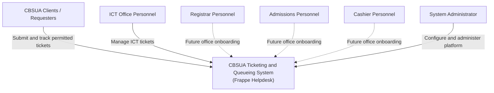
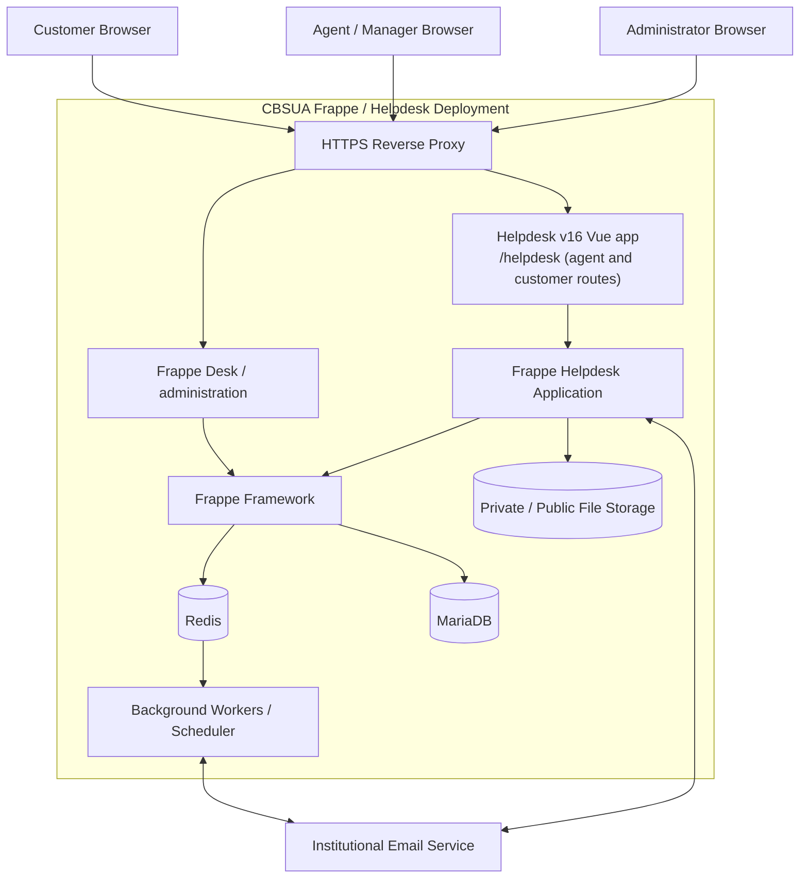
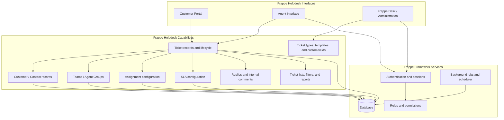
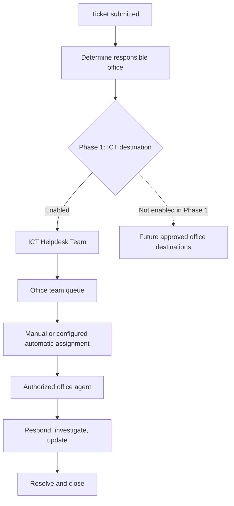
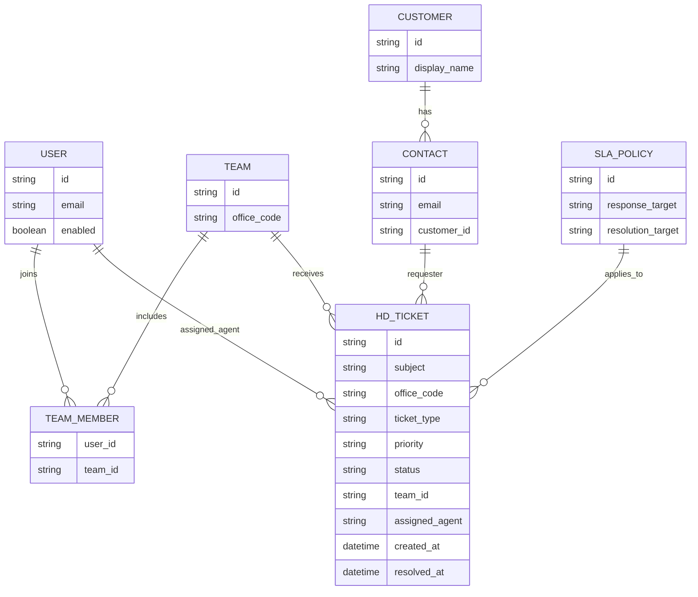
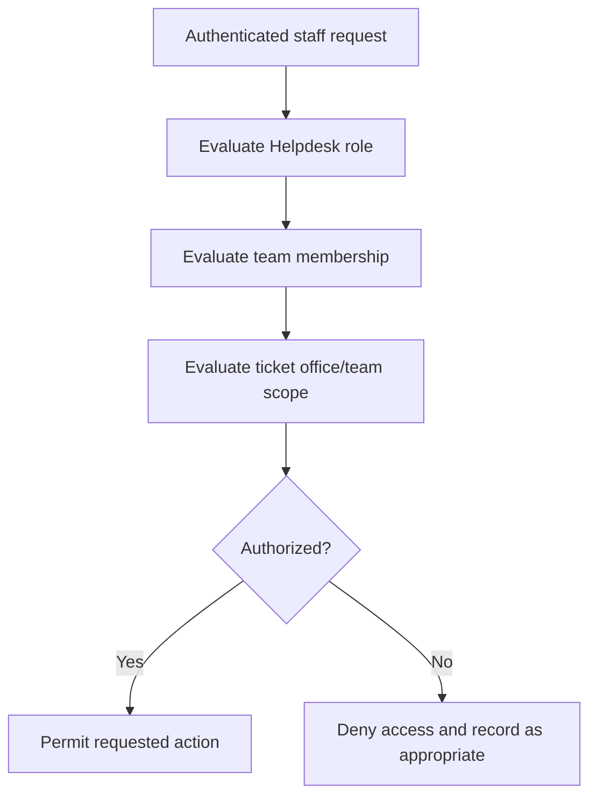

# System Architecture

**Architecture style:** Single shared Frappe Helpdesk deployment with phased office onboarding.  
**System of record for tickets:** Frappe Helpdesk.  
**Customization principle:** Configure native Helpdesk capabilities first; add a CBSUA app extension only for verified gaps.

## 1. Architecture principles

1. Frappe Helpdesk is the ticketing application; do not recreate its ticket engine.
2. Frappe Framework provides the underlying application, authentication, permissions, persistence, and background processing.
3. One deployment serves multiple office teams.
4. ICT is the only active office in Phase 1.
5. Office-level access isolation is a release gate, not an assumption.
6. Custom fields and configuration should be preferred over custom ticket services.
7. Version compatibility must be pinned and verified before implementation.

## 2. C4 Level 1 — System context

## 3. C4 Level 2 — Container view

The diagram is logical. Exact deployment topology (single server, separate workers, managed database, object storage, and reverse proxy) is a deployment decision to be finalized.

Email is an optional integration for the initial release unless stakeholders require email-to-ticket intake or outbound email notifications at launch.

## 4. C4 Level 3 — Logical Helpdesk components

This is a conceptual mapping of product capabilities, not a promise that every box is a separate deployable service or DocType. Validate actual feature names and availability against the pinned Helpdesk release.

## 5. Office queue and routing model

For Phase 1, the customer intake experience must not expose future office destinations. The office/team association must be stored or derived consistently and used by access-control rules and reporting.

## 6. Conceptual data model

This model is conceptual only. It is not a statement of exact Helpdesk database schema. The implementation must inspect the selected release's DocTypes and use native fields wherever possible. `office_code` may be a custom field or a value derived from an approved team-to-office mapping. Avoid duplicating native records.

## 7. Authorization boundary

Required tests include direct ticket URL access, list filtering, search, reports, attachments, comments, assignment changes, and manager-level actions. Hiding a ticket from a list is not sufficient if it remains accessible through another route.

## 8. Deployment considerations

- Pin mutually compatible Frappe Framework and Frappe Helpdesk versions.
- Use HTTPS in production.
- Separate development, test/staging, and production environments where feasible.
- Back up the database and file storage together.
- Test restore procedures before production acceptance.
- Restrict administrative access.
- Document worker, scheduler, email, and storage configuration.
- Keep CBSUA customizations in version control and cover them with automated or repeatable tests.

## 9. Architecture decisions requiring validation

- Exact supported Frappe and Helpdesk release pair.
- Native team-level permission behavior and whether office isolation needs an extension.
- Customer portal authentication and anonymous ticket policy.
- Email intake and notification requirements.
- Whether an explicit Office DocType is needed or team metadata is sufficient.
- Reporting capabilities and whether custom reports are required.
