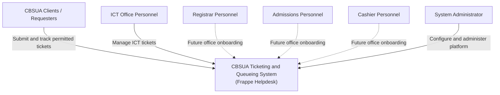
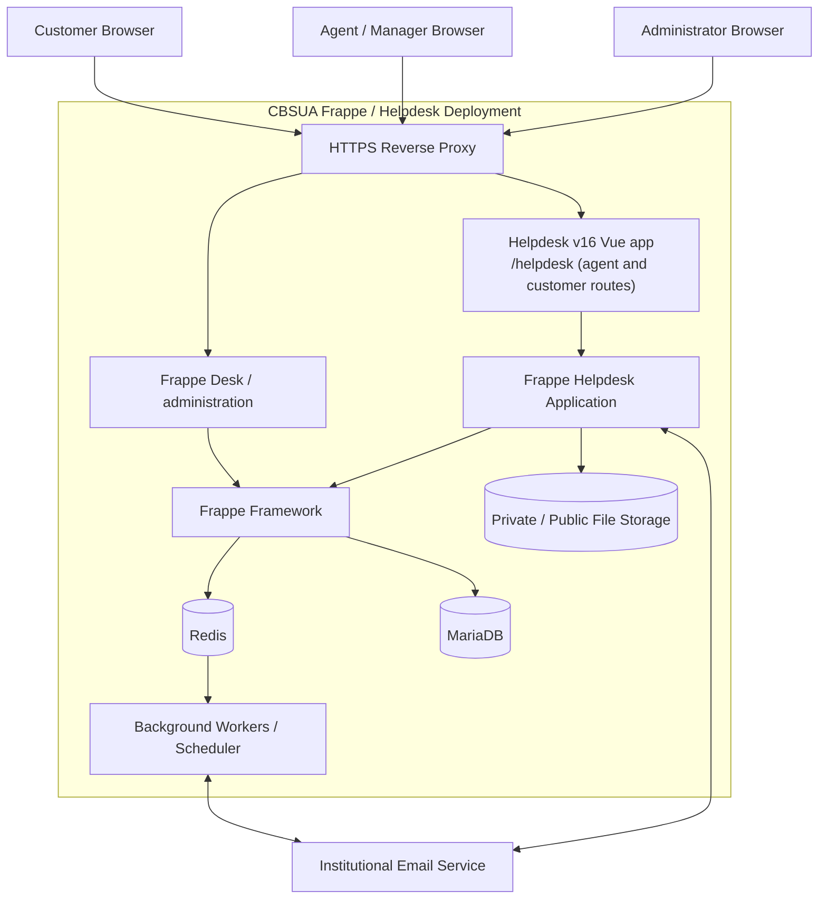
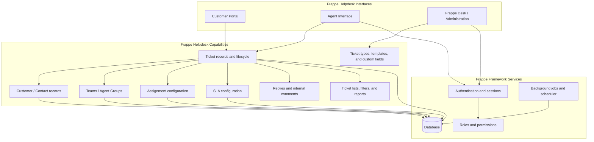
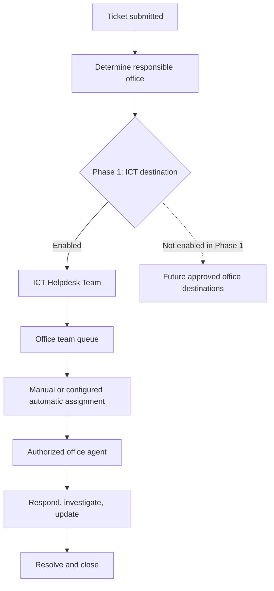
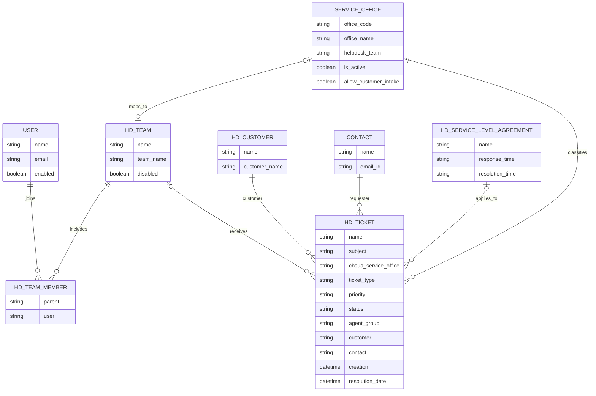
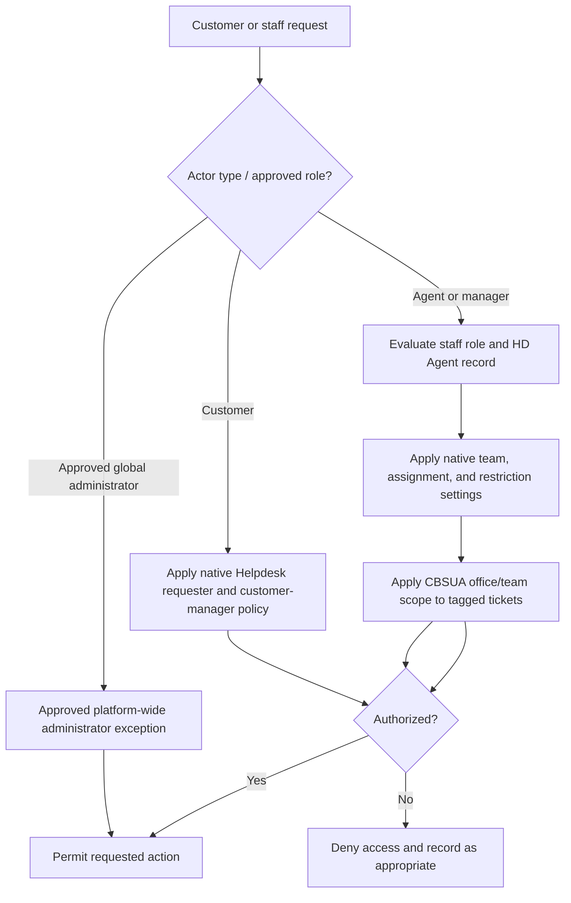

# System Architecture

**Architecture style:** Single shared Frappe Helpdesk deployment with phased office onboarding.  
**System of record for tickets:** Frappe Helpdesk.  
**Customization principle:** Configure native Helpdesk capabilities first; add a CBSUA app extension only for verified gaps.

## 1. Architecture principles

1. Frappe Helpdesk is the ticketing application; do not recreate its ticket engine.
2. Frappe Framework provides the underlying application, authentication, permissions, persistence, and background processing.
3. One deployment serves multiple office teams.
4. ICT is the only active office in Phase 1.
5. Office-level access isolation is a release gate, not an assumption.
6. Custom fields and configuration should be preferred over custom ticket services.
7. Version compatibility must be pinned and verified before implementation.
8. Native Helpdesk team restrictions are evaluated before adding CBSUA permission hooks.
9. Office assignment and its customer visibility are separate decisions; a hidden form field is not an API security boundary.
10. Generic Frappe skill examples are illustrative only; verify permission and schema behavior against the pinned framework and installed Helpdesk source.

## 2. C4 Level 1 — System context

## 3. C4 Level 2 — Container view

The diagram is logical. Exact deployment topology (single server, separate workers, managed database, object storage, and reverse proxy) is a deployment decision to be finalized. Frappe Helpdesk and `cbsua_helpdesk` run as apps in the same Frappe site/runtime; their boxes below describe responsibilities, not independent services.

Email is an optional integration for the initial release unless stakeholders require email-to-ticket intake or outbound email notifications at launch.

## 4. C4 Level 3 — Logical Helpdesk components

This is a conceptual mapping of product capabilities, not a promise that every box is a separate deployable service or DocType. Validate actual feature names and availability against the pinned Helpdesk release.

## 5. Office queue and routing model

For Phase 1, the customer intake experience must not expose future office destinations. The office/team association must be stored or derived consistently and used by access-control rules and reporting.

## 6. Conceptual data model

This model shows ownership as well as relationships. `CBSUA Service Office` and `HD Ticket.cbsua_service_office` are CBSUA-owned; `HD Ticket`, `HD Team`, `HD Team Member`, `HD Customer`, `Contact`, and `HD Service Level Agreement` are native Frappe/Helpdesk records. A Helpdesk team can be mapped to at most one service office; an office may be unmapped until its team is approved. Team membership remains in Helpdesk's native child table. The names `agent_group`, `customer`, `contact`, `ticket_type`, and `priority` are the installed Helpdesk ticket fields; individual assignment is managed by Helpdesk's assignment metadata rather than a CBSUA `assigned_agent` field. Do not duplicate native records.

The office field is currently created at permission level 7. Current Helpdesk field-permission guidance gives level 7 to customers and agents, while level 8 is agent-only. The `HD Ticket Template` visibility setting controls the Helpdesk form, but field permission level controls whether a value is returned by the API. Decide whether office classification is customer-visible before production. If it is internal, use the agent-only level and configure any custom agent role permissions accordingly. See [Helpdesk ticket field visibility](https://docs.frappe.io/helpdesk/customization/perm-levels-in-helpdesk).

## 7. Authorization boundary

Use native Helpdesk team restriction settings as the first control to evaluate. The installed Helpdesk includes `Restrict tickets by Team`, `Do not restrict tickets without a Team`, and `Restrict agent assignment to selected Team`. The no-team option can expose unassigned tickets to every team; native checks can also allow explicitly assigned agents and teams marked to ignore restrictions. Verify each exception against the approved office policy, including administrator and manager roles, before deciding whether the CBSUA hooks are needed. See [Helpdesk team restrictions](https://docs.frappe.io/helpdesk/settings).

Frappe's `permission_query_conditions` hook filters `frappe.get_list` queries and does not filter `frappe.get_all`; a document `has_permission` hook is a separate control. Neither client-side filtering nor a hidden field is a complete access boundary. Verify direct ticket reads and writes, REST/RPC methods, Helpdesk search, reports and exports, comments, attachments and downloads, direct assignments, teamless tickets, users in multiple teams, and global administrative roles with separate accounts. See [Frappe permission hooks](https://docs.frappe.io/framework/user/en/python-api/hooks) and [Helpdesk field permissions](https://docs.frappe.io/helpdesk/customization/perm-levels-in-helpdesk).

The M1 implementation currently scopes CBSUA-tagged tickets to the mapped office team. Untagged legacy tickets remain under native Helpdesk permissions. That behavior is a compatibility choice, not proof of cross-office isolation; agree a backfill or exclusion policy before enabling multiple offices.

## 8. Deployment considerations

- Pin mutually compatible Frappe Framework and Frappe Helpdesk versions.
- Use HTTPS in production.
- Separate development, test/staging, and production environments where feasible.
- Back up the database and file storage together.
- Test restore procedures before production acceptance.
- Restrict administrative access.
- Document worker, scheduler, email, and storage configuration.
- Keep CBSUA customizations in version control and cover them with automated or repeatable tests.
- A Git branch and a Frappe Site solve different isolation needs: `site-test` selects source, while a separate Site has its own database and site configuration. Follow [the clean Site test runbook](site-test/README.md). A successful clean install verifies schema/install behavior, not migration of old ticket data or end-to-end office isolation.
- Before a multi-office rollout, decide how untagged and teamless tickets are handled and verify that no default Helpdesk setting makes them visible across office teams.
- Define explicit exceptions for platform administrators and central support roles. Do not treat an Agent or Agent Manager role alone as office isolation.

## 9. Architecture decisions requiring validation

- Exact supported Frappe and Helpdesk release pair.
- Native team-level permission behavior and whether office isolation needs an extension.
- Whether the `cbsua_service_office` field may be read by customers (current permlevel 7) or must be agent-only (permlevel 8).
- How existing untagged tickets, unassigned tickets, direct assignees, and Helpdesk teams configured to ignore restrictions are handled before office isolation is enabled.
- Which central administrator or cross-office support roles may intentionally bypass office restrictions.
- Customer portal authentication and anonymous ticket policy.
- Email intake and notification requirements.
- Whether an explicit Office DocType is needed or team metadata is sufficient.
- Reporting capabilities and whether custom reports are required.
