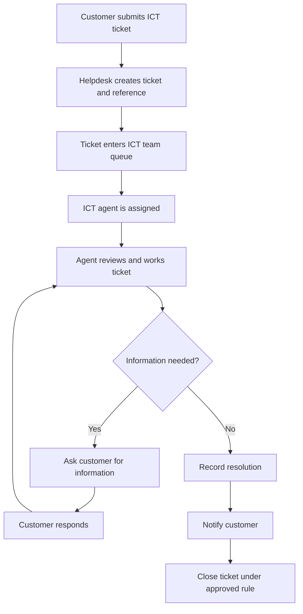
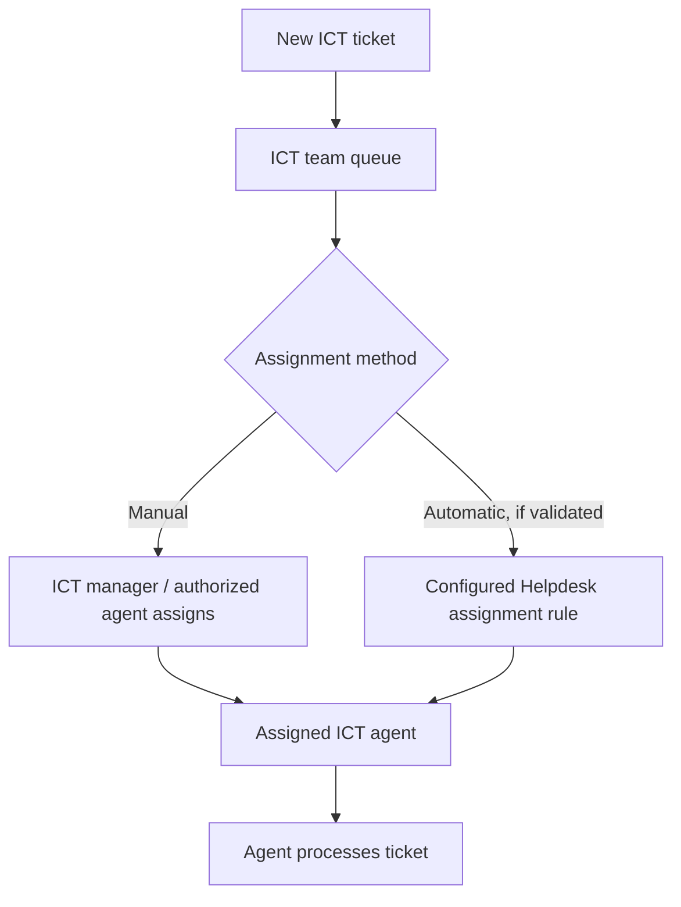
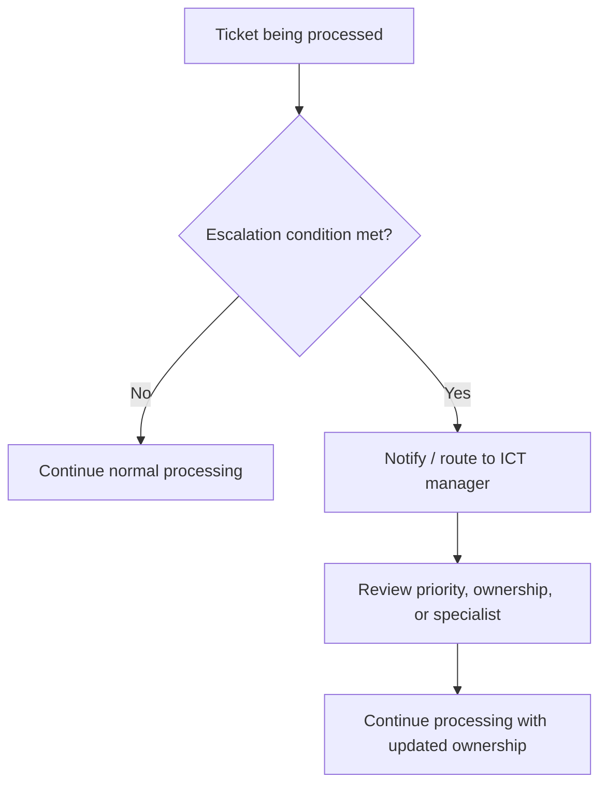
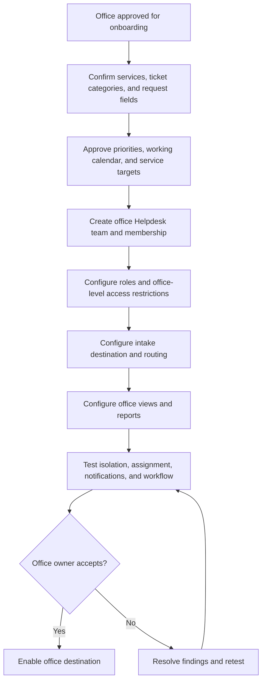

# Ticketing Workflows

## 1. Phase 1 ICT ticket lifecycle

The exact status values and transitions must be aligned to the selected Helpdesk version. The diagram describes the intended business process, not a claim that these exact status labels are built in.

## 2. Assignment workflow

Automatic assignment is optional until the team confirms workload and fairness rules and validates the feature in the pinned release.

## 3. Escalation workflow

Escalation triggers (age, priority, SLA risk, or specialist need) and manager actions must be approved by ICT.

## 4. Future office onboarding workflow

## 5. Customer access policy

Before production, stakeholders must choose one of the following policies:

- Authenticated customer accounts only.
- Anonymous submission with secure reference-based follow-up.
- A mixed model with defined eligibility and safeguards.

The implementation must verify that a customer can only see tickets they are authorized to access. The policy must also address identity verification, sensitive attachments, retention, and account recovery.

## 6. Operational exception cases to test

- Ticket submitted with missing or invalid required information.
- Ticket routed to an unavailable or disabled team.
- Agent account disabled while tickets remain assigned.
- Ticket reassigned to another agent or team.
- Customer replies after a ticket is resolved or closed.
- Duplicate or repeated ticket submissions.
- Attachment rejected due to type or size policy.
- Notification delivery failure.
- SLA calendar boundary, holiday, and after-hours behavior.
- Unauthorized user attempts to open a ticket directly.
